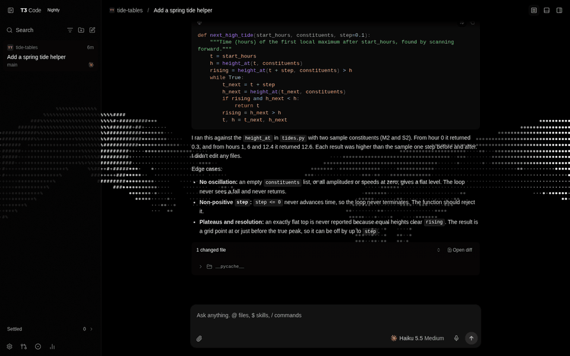
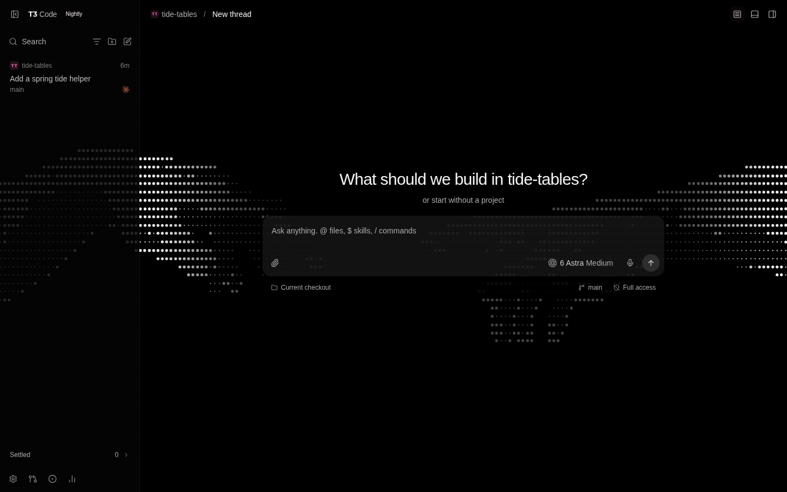
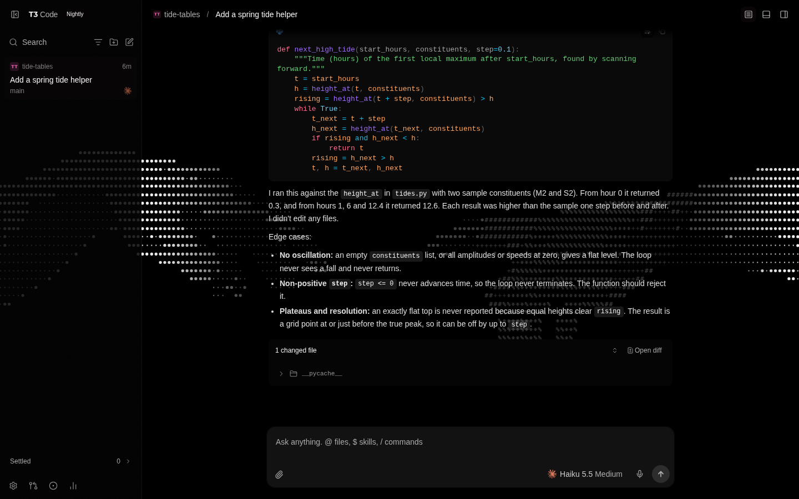

# Reaching

A dark theme for [T3 Code](https://t3.codes) that draws the Reaching backdrop from
[neverblinks/backdrops](https://github.com/neverblinks/backdrops) behind the app: two hands in dots, after
Michelangelo's fresco. Every 7.5 seconds one wave crosses from arm to arm and turns the dots it passes into ASCII.



The artwork is by @samdape and is not free to redistribute. This repository is private.
Read [Credits and licence](#credits-and-licence) before you share it or make it public.

## Screenshots





The screenshots show T3 Code with an invented demo project.

## Install

1. Download [`theme.json`](theme.json).
2. In T3 Code, open **Settings**, then **Appearance**.
3. Under **Themes**, click **Add theme**.
4. Click **Choose files**, select `theme.json`, then click **Add theme**.

Or copy the file into T3 Code's theme folder as `reaching.json` and pick **Reaching** on the same page:

```sh
cp theme.json ~/.t3/userdata/themes/reaching.json
```

To go back, pick another theme on the same page.

Tested on T3 Code 0.1.11-nightly.20261118, in the web client in Chromium.

## What the theme changes

- **Backdrop.** Upstream's picture fills the window, behind the sidebar, the header and the chat.
- **Colours.** Upstream's Reaching palette: black surfaces, white text, a grey accent, colour for errors and warnings only.
- **Reading lane.** The picture is dimmed with black at 74 % behind the chat's text column, and clears over 13 rem on each side. The brightest dot behind text reads `#3f3f3f`, the same as upstream.
- **Sidebar and header.** Black at 86 %, so the picture shows through faintly.

The chat's layout, message rows, composer and code blocks are T3 Code's own.

## What moves

One wave, every 7.5 seconds, in 60 steps of 0.125 seconds. On the hands a dot becomes `+` or `#`, then `*` or `%`,
then goes back. On the forearms, which only wide windows show, it becomes `*` or `%` only.

Nothing else moves. If your system asks for reduced motion, the wave stops.

## Change it

The theme is generated. Edit the constants at the top of `build.mjs`, then build again.

| Constant | What it does | Default |
|---|---|---|
| `LANE.opacity` | How dark the lane behind the chat text is | `0.74` |
| `LANE.pad` | How far the full dimming reaches past the text column on each side | `1rem` |
| `LANE.fade` | How far the lane takes to clear on each side | `13rem` |
| `PANEL_ALPHA` | Opacity of the black behind the sidebar and the header | `0.86` |

## Build from source

You need Node.js. The build is tested with Node.js 26.

```sh
npm ci
node build.mjs
```

`build.mjs` reads upstream's scene from `vendor/backdrops/scene-reaching.js` and writes `theme.json`.

T3 Code holds 100,000 characters of theme CSS, and upstream's scene is 117,967 characters. `build.mjs` rewrites
the scene to 68,735 characters that draw the same picture. Upstream writes one path for every stroke of every glyph
in each of the wave's 52 bands. Most of those paths are the same runs of dots, shifted. The build writes each
band's runs once and draws every stroke family from them with `<use>`.

To check the result, run:

```sh
node check.mjs
```

`check.mjs` needs a Chromium binary. If yours is not at `/usr/bin/chromium`, set `CHROMIUM` to its path. It checks that:

- `theme.json` is what `build.mjs` produces and fits T3 Code's limits.
- Text keeps its contrast over the brightest dot behind the chat: 7:1 for main text, 4.5:1 for muted text.
- The rewritten scene draws what upstream's scene draws, at 12 moments of the wave and two window sizes: no pixel may be more than 32 of 255 levels apart. It writes `compare-*.png`, upstream on the left and this theme on the right.
- Drawn as a CSS background, the way T3 Code draws it, the wave runs through the same frames.
- T3 Code still has the parts of the app the theme hooks into. On Linux it finds a running T3 Code AppImage by itself. Otherwise set `T3_APP_ASAR` to the path of T3 Code's `app.asar`.

## Update from upstream

Copy the new `plugins/reaching/hooks/scene-reaching.js`, `LICENSE` and `ARTWORK.md` into `vendor/backdrops/`,
write the commit hash to `vendor/backdrops/COMMIT`, then run `node build.mjs` and `node check.mjs`.
If upstream changed how it writes the scene, the build stops with a message that names the part it could not read.

## Limits

- **Size.** The theme uses 71,743 of T3 Code's 100,000 characters of CSS.
- **Internal names.** The reading lane follows the chat column through three CSS variables T3 Code sets, and the
  backdrop shows through boxes T3 Code's theme guide does not list as stable. A T3 Code update can rename one.
  The lane then centres on the chat area, or a box turns solid again. `node check.mjs` reports which names are missing.
- **Dark only.** The theme defines a dark appearance.
- **Mobile.** T3 Code's theme guide says its mobile apps do not use themes.

## Credits and licence

The picture and its wave come from [neverblinks/backdrops](https://github.com/neverblinks/backdrops), at the commit
in `vendor/backdrops/COMMIT`. Upstream's terms are in `vendor/backdrops/LICENSE` and `vendor/backdrops/ARTWORK.md`:

- The hands are @samdape's artwork, used upstream with permission. All rights stay with the artist.
- The forearms past the artwork's edges are upstream's extension, traced from the public-domain fresco.
- Anyone may use the theme for free, for any purpose. Nobody may redistribute the picture outside upstream's
  repository, sell it, or remove the credits, without permission.

`theme.json` contains the picture, so those terms cover it. Ask neverblinks and @samdape before you make this
repository public or pass `theme.json` on.

`build.mjs` and `check.mjs` are under the [MIT License](LICENSE). [NOTICE.md](NOTICE.md) has the details.

This theme is not affiliated with T3 Code, neverblinks or Anthropic.
